# Pocket Password Storage (PPS)

**Current firmware: `2.1.4`** · ESP32-C3 · local password vault · on-device PIN + HTTPS Web UI

Pocket Password Storage is a small, locally operated password manager built around an ESP32 and a TFT display. Passwords are held in encrypted flash storage, accessed using the device's physical controls or over its local HTTPS interface. It does not require a cloud account or an Internet connection; Wi-Fi is used for local access.

> [!NOTE]
> Most of the code was written with `ChatGPT`, namely `o3` and `4o` models.
> Code was tested on testboard `(ESP32C3 + Air101-LCD)` and edited/fixed by myself when needed.
>
> All development further is made with `GPT 5` and then continued with `GPT 6 Astra Max`

> [!WARNING]
> **Experimental proof of concept, not a production-grade security product.** The project has not undergone an independent security audit. Hardware behavior, entropy quality, recovery, and current browser/SDK compatibility have not been comprehensively tested. A vault containing important passwords must have independently verified external backups. The software is provided **as is**, without a warranty; you use it at your own risk.
>
> **Upgrading a device that already contains data?** Read [Safe firmware upgrades](#safe-firmware-upgrades) **before uploading**. Preserve your existing partition table, back up the entire flash, and never use flash erase, SPIFFS format, or filesystem upload during a data-preserving update.

## Contents

- [Test board and UI](#test-board-and-ui)
- [Project history and alternatives](#project-history-and-alternatives)
- [Repository layout](#repository-layout)
- [Hardware and build requirements](#hardware-and-build-requirements)
- [Development workflow: `web/`, `tools/`, and firmware](#development-workflow-web-tools-and-firmware)
- [Initial setup and everyday use](#initial-setup-and-everyday-use)
- [Security features and limitations](#security-features-and-limitations)
- [Device-specific TLS trust](#device-specific-tls-trust)
- [TLS maintenance and troubleshooting](#tls-maintenance-and-troubleshooting)
- [Migration, rollback, and recovery](#migration-rollback-and-recovery)

## Test board and UI

<details>

<summary>Pinout for LUATOS ESP32-C3 + Air101-LCD</summary>

### Here is the pinout of both boards. In case you need it for further development.

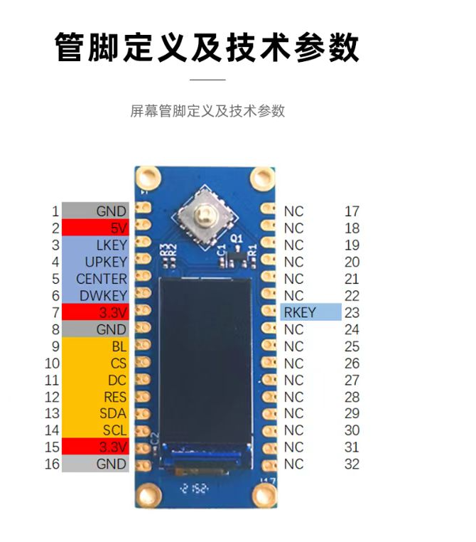

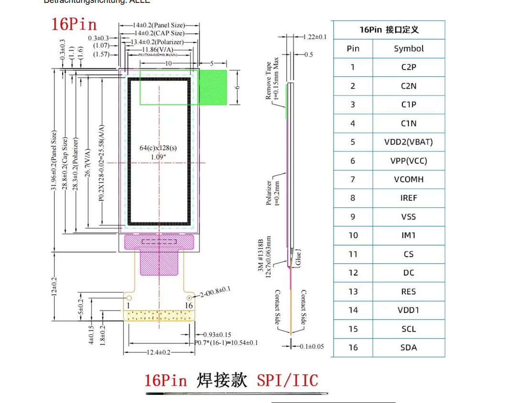

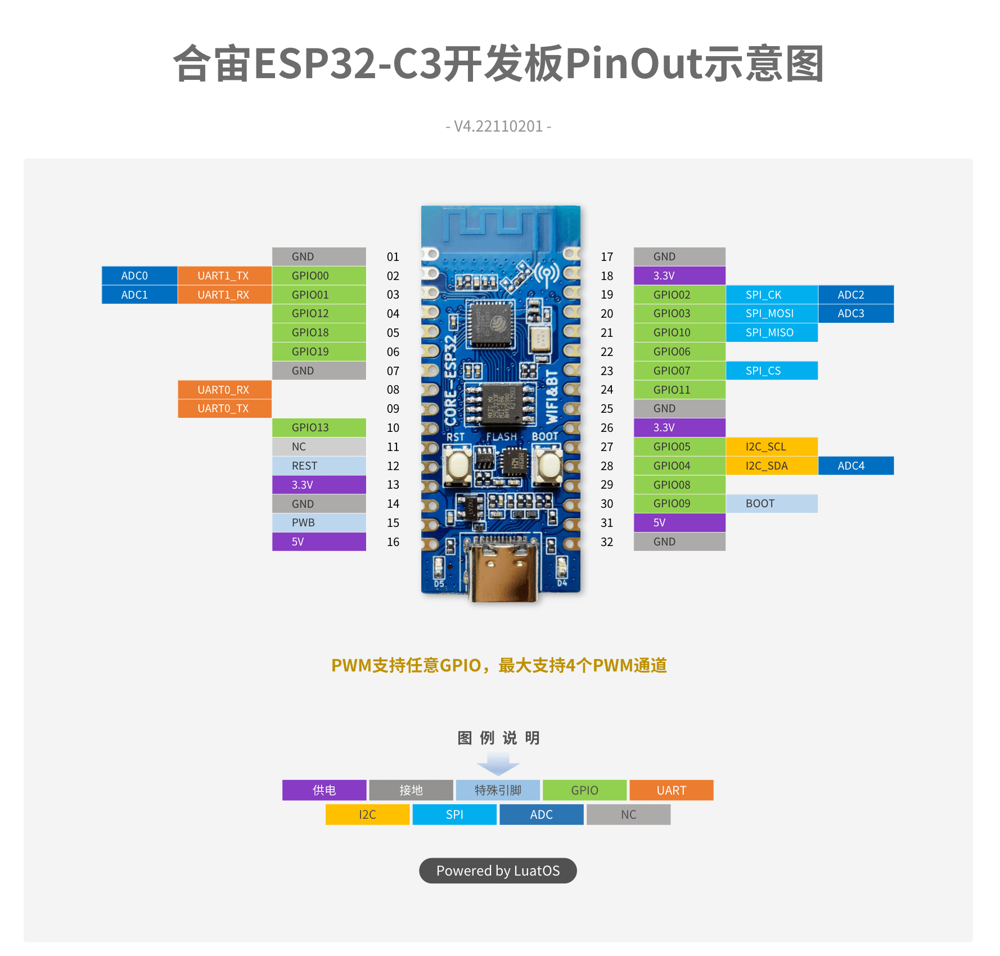

</details>

<details>

<summary>Real view of boards (LUATOS ESP32-C3 + Air101-LCD)</summary>

### Here is how the baord looks like (I used it for testing)

> It's a bit thick but quite nice kit. You can buy them both on Aliexpress, solder them together and use right away. I use this boards by myself.

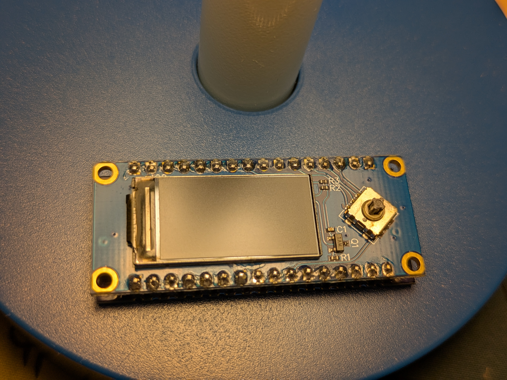

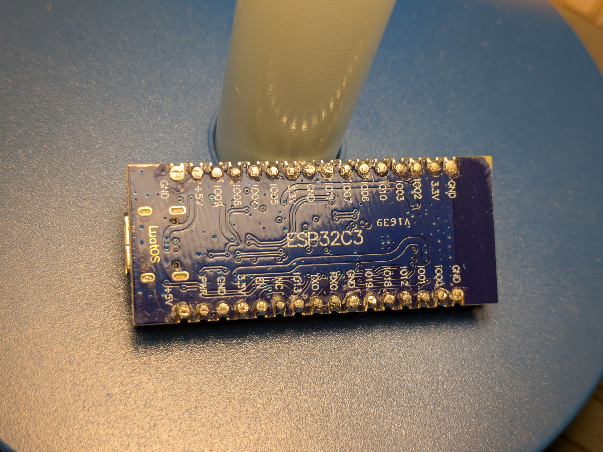

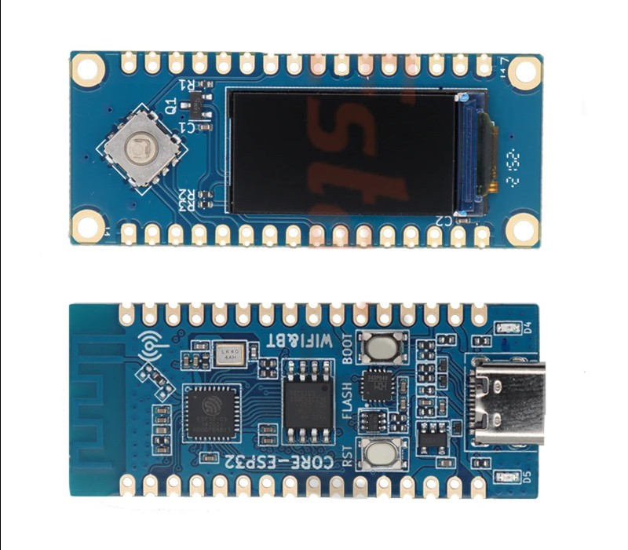


</details>


<details>

<summary>Board UI</summary>

### Here is a few pics of UI

> Logo can be changed to anything. It is located in `Logo.h` file.

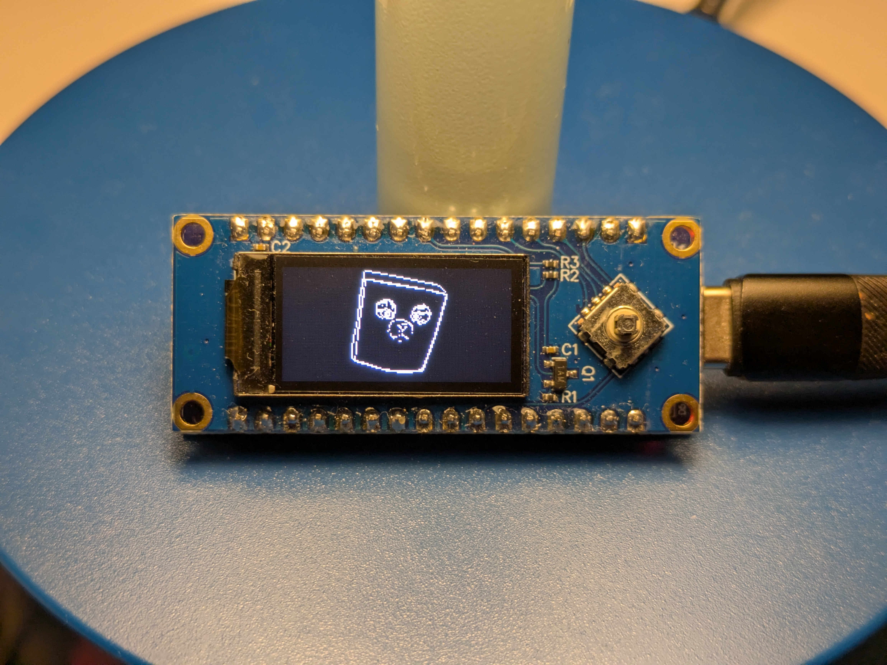

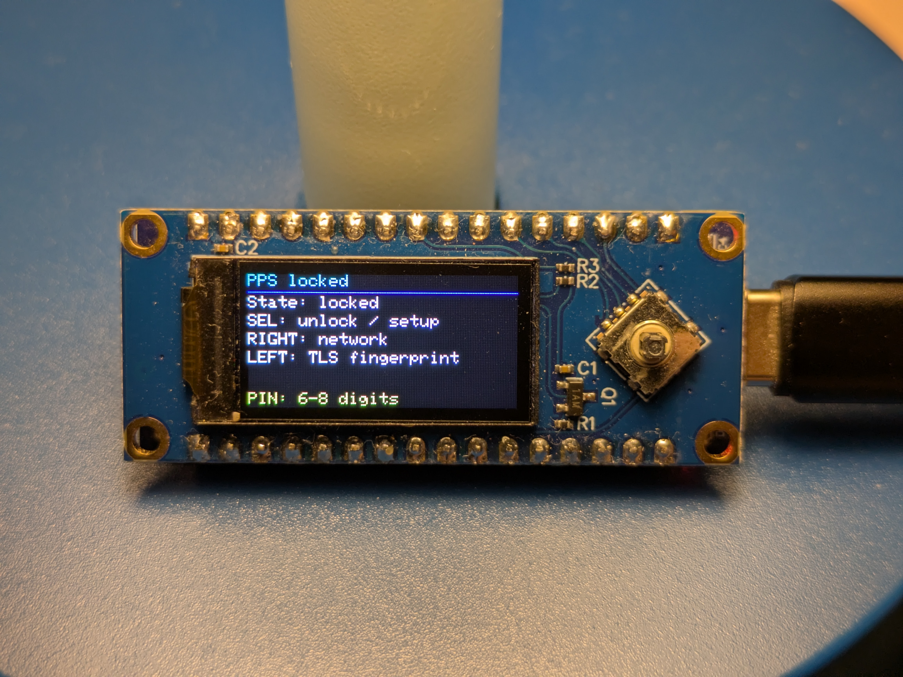

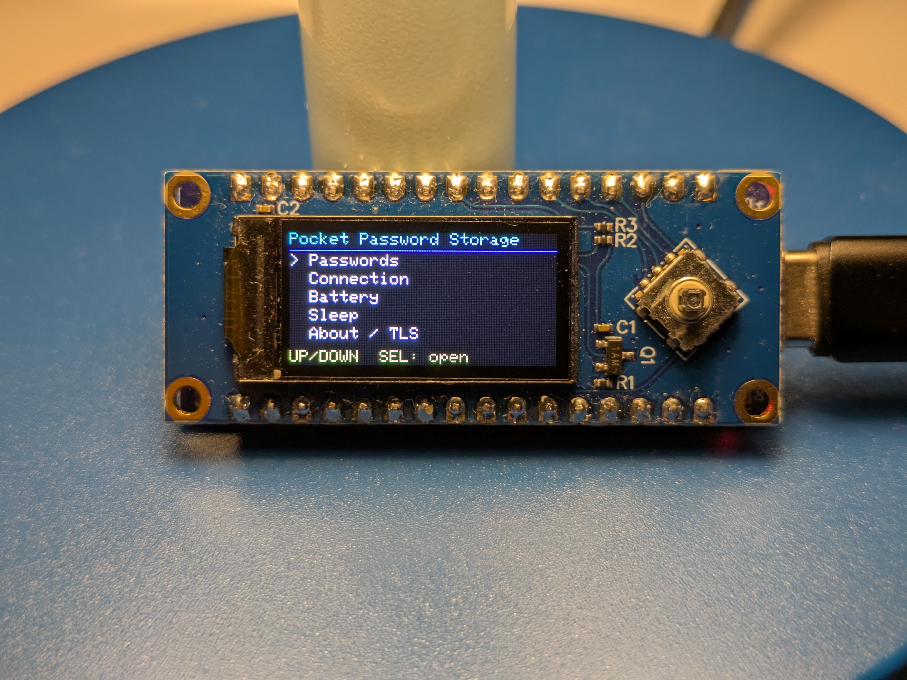

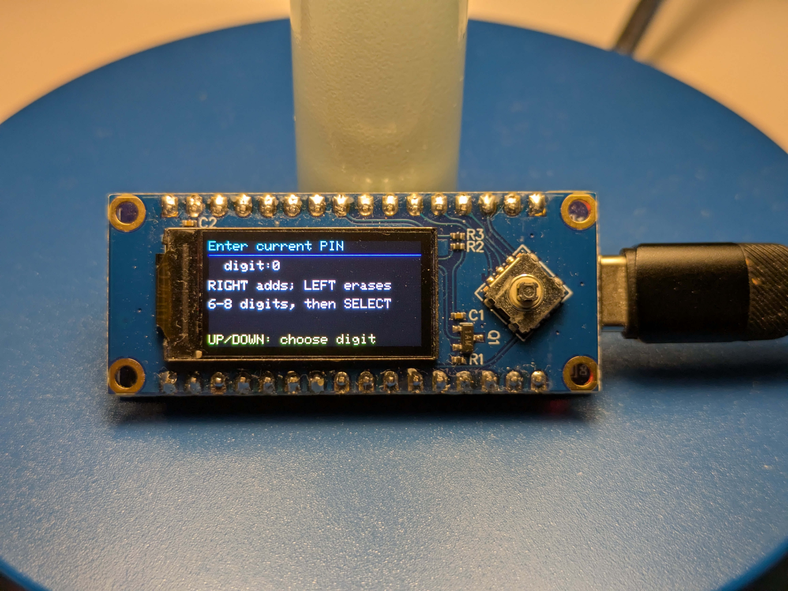

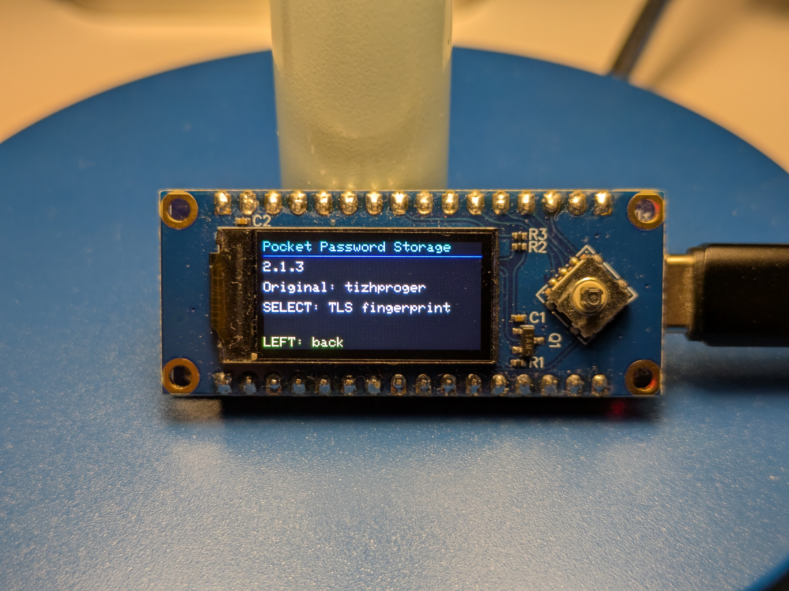

</details>

## Project history and alternatives

| Version | Historical context |
| --- | --- |
| `1.0.0` | Initial encryption and basic device UI. |
| `1.1.0` | Bug fixes and first Web UI. |
| `1.2.0` | Core functions added; troubleshooting and testing still needed. |
| `1.2.1` | Device UI/styling improvements and new PIN entry. |
| `1.3.0` | Live Wi-Fi mode update, PIN change, and PIN-entry fixes. |
| `2.0.0` | Earlier protected v2 storage implementation; **cannot read v3 snapshots**. |
| **`2.1.0`** | Security-focused rewrite of the earlier codebase: authorized API, per-device HTTPS identity, encrypted journaled storage, strict validation, local controls, and embedded Web UI. |
| **`2.1.1-recovery`** | Added a PIN-authorized way to migrate legacy data when the old master password is unavailable, plus offline flash-backup inspection and recovery tests. |
| **`2.1.2-TLS`** | Device-specific TLS trust patch described in the TLS instructions. |
| **`2.1.3`** | Extensive rework with updated toolchain/dependencies, TLS integration, Web UI workflow and larger vault limits. **The special 2.1.1 legacy-PIN recovery flow is not in this source tree.** |
| **`2.1.4` (current)** | Improved WebUI usability. Added possibility to write cryptographic keys and seed phrases. Added filtration by tags and search. Now view entered password is possible. |

### Alternative branch: `SoloVault` (initial version `0.1.0`)

**SoloVault is a separate, from-scratch firmware architecture**, not another PPS 2.x update. Its initial `0.1.0` design carries over only the previously confirmed display/button pinout and ST7735 configuration; the PPS application sources, web client, authentication mechanisms, storage, backups and migration procedures are **not reused**.

| Topic | PPS 2.1.4 | SoloVault 0.1.0 |
| --- | --- | --- |
| Access | Local HTTPS Web UI and physical buttons | Physical buttons/display plus board-approved USB serial; **no Wi-Fi/BLE/HTTP/OTA** |
| Unlock model | Master password and 6–8-digit physical PIN | Random **20-character / 100-bit owner code** generated and entered on the device |
| Capacity | **128** entries | **32** entries |
| Storage and backups | PPS protected v3 snapshots and PPS backup format | Independent AES-256-GCM snapshot **format 1**, `.solovault` encrypted backups |
| Host tools | `web/`, `tools/embed_web.py`, `TLS_Trust_Kit/` | Python `desktop/solovault.py` client and `tools/remove_coredump.py` partition helper |
| SDK in supplied documentation | Arduino-ESP32 **3.x** for PPS 2.1.3 | Arduino-ESP32 **2.0.17** pinned prototype environment |
| Recovery/migration | Legacy PPS migration and protected snapshot recovery | Explicit read-only interrupted-write recovery; **no PPS migration or cross-format import** |

SoloVault additionally refuses to load/create secrets with a `data,coredump` partition or unsafe UART core-dump configuration, because crash dumps can retain sensitive RAM. Its USB interface has **no stored-password read command**, though passwords typed on a PC for new entries travel over USB **in plaintext**, so the PC must be trusted. The project is experimental and unaudited. The SoloVault branch has its own full README, architecture, USB format etc.

**Do not flash SoloVault as an in-place PPS firmware upgrade.** Its format, backup files and keys are incompatible with PPS, and changes to partitions may destroy access to old data. Save and verify PPS backups before testing.

## Repository layout

The supplied `PPS.zip` contains these components:

```text
PPS/
  PPS.ino                 Arduino sketch entry point
  config.h                Firmware 2.1.3, pinout, limits, timing
  partitions.csv          Example board's exact custom flash layout
  app.*, ui.*             Authentication, sessions, buttons/TFT UI
  storage.*, journal.h    Encrypted vault, journaling, migration, recovery
  crypto.*                Randomness, KDF, authenticated encryption
  pps_network.*           AP/STA Wi-Fi, DNS, mDNS, network settings
  web.*, web_assets.h     HTTPS server, API, embedded browser assets
  pps_tls_override.h      Optional, device-specific CA-signed certificate
  pps_* / secure.h        Memory, JSON, Mbed TLS, dependency checks
  Logo.h                  Embedded display artwork
TLS_Trust_Kit/
  pps_tls.py              Fetch, inspect, and issue TLS certificates
  requirements.txt        Host-side Python dependency
web/
  index.html              Browser UI source
  script.js               Browser logic and Web Crypto backups
  style.css               Styles for the browser UI
tools/
  embed_web.py            Generate/check PPS/web_assets.h
README.md                 This guide
```

**Important:** `web/` contains **source assets**. Firmware serves the compiled `PPS/web_assets.h`, not files loaded from SPIFFS. `TLS_Trust_Kit/` is a separate host-side certificate utility; its output is integrated through `PPS/pps_tls_override.h` and `PPS/web.cpp`. The two workflows are explained in [Development workflow](#development-workflow-web-tools-and-firmware) and [Device-specific TLS trust](#device-specific-tls-trust).

## Hardware and build requirements

### Target hardware and software

| Component | Current requirement or source configuration |
| --- | --- |
| Board | ESP32-C3; originally exercised on ESP32-C3 + Air101-LCD hardware. |
| Arduino board package | **Arduino-ESP32 3.x**. `arduino_build_check.h` rejects 2.x. |
| Cryptography SDK | **Mbed TLS 3.x**, at least **3.6.3** according to `pps_dependency_check.h`; below 3.6.7 the source warns that an SDK security fix/backport needs review. Confirm the actual bundled SDK. |
| JSON library | **ArduinoJson 7.4.3 or later within 7.x**; the build enforces `ARDUINOJSON_POOL_CAPACITY=16`. |
| Language | **C++17**, checked at compile time. |
| Display libraries | **Adafruit GFX** and **Adafruit ST7735** (plus Arduino SPI/TFT dependencies). |
| Certificate tooling | **Python 3.11+** and `TLS_Trust_Kit/requirements.txt` (`cryptography==50.0.2` in the supplied archive). |
| Flash layout | Supplied custom CSV for **4 MiB** flash; use it only with a compatible board/data layout. |

### Test-board pinout

These values are taken from `PPS/config.h` and must be reviewed for other boards:

| Function | GPIO | Function | GPIO |
| --- | ---: | --- | ---: |
| UP | 8 | DOWN | 13 |
| LEFT | 5 | RIGHT | 9 |
| SELECT | 4 | TFT SCLK | 2 |
| TFT MOSI | 3 | TFT MISO | disabled (`-1`) |
| TFT RST | 10 | TFT DC | 6 |
| TFT CS | 7 | Battery ADC | 0 |
| Backlight | not controlled (`-1`) | | |

Battery scaling uses `DIVIDER=2.0` and `CALIBRATION=1.0`; the UI's 3.2–4.2 V percentage estimate is approximate.

### Partition map and flashing

The archive includes **`PPS/partitions.csv`**, whose actual layout is:

| Partition | Offset | Size |
| --- | --- | --- |
| `nvs` | `0x9000` | `0x5000` |
| `otadata` | `0xE000` | `0x2000` |
| `app0` | `0x10000` | `0x200000` (2 MiB) |
| Unallocated reserve | `0x210000` | `0x80000` (512 KiB) |
| `spiffs` | `0x290000` | `0x160000` (1.375 MiB) |
| `coredump` | `0x3F0000` | `0x10000` |

The CSV comments mention the Arduino IDE **No OTA (2MB APP/2MB SPIFFS)** menu selection, but **the custom CSV's actual SPIFFS size is `0x160000`, not 2 MiB**. Confirm that your build uses the intended CSV; do not substitute the menu's generic partition layout for an existing data-bearing device.

1. Open **`PPS/PPS.ino`** in Arduino IDE and select your working ESP32-C3 board, port, the compatible Arduino-ESP32 3.x installation and required libraries.
2. Confirm the C++17/compiler and partition settings; verify the application fits within the 2 MiB `app0` partition. Existing installations must keep their **original offsets and sizes**, even if these differ from the included example.
3. After any changes to `web/`, [regenerate and check the embedded assets](#development-workflow-web-tools-and-firmware).
4. Use **Verify**, then the normal **Upload** operation. Disable **Erase All Flash Before Sketch Upload**. Do **not** format SPIFFS, run `uploadfs`, erase NVS, or install a separate Web UI filesystem image while preserving data.

The firmware does **not** automatically configure eFuses, Secure Boot, or Flash Encryption. This project uses a normal sketch upload, **not an OTA update**.

## Development workflow: `web/`, `tools/`, and firmware

The browser and firmware must be built **together**:

```text
web/index.html + web/script.js + web/style.css
                 |
                 v
        tools/embed_web.py
                 |
                 v
        PPS/web_assets.h  <-----  PPS/config.h (limits via C++ macros)
                 |
                 v
        PPS/web.cpp HTTPS routes: /, /script.js, /style.css
                 |
                 v
           PPS/PPS.ino -> Verify -> Upload

TLS_Trust_Kit/pps_tls.py -> issued-XX/pps_tls_certificate.h
                                      |
                                      v
                          PPS/pps_tls_certificate.h (optional)
                                      |
                                      v
                          PPS/pps_tls_override.h -> PPS/web.cpp
```

### Editing the Web UI

- Edit the **three source files** in `web/`; do not hand-edit generated `PPS/web_assets.h`.
- `web/script.js` intentionally uses `PPS_LIMITS`. **The generator injects those constants from `PPS_MAX_ENTRIES` and `PPS_VAULT_MAX_BYTES` in `PPS/config.h`**. Simply embedding `script.js` as a raw string without this prefix will break the UI. Do not independently hard-code different browser limits.
- From the **repository root**, run:

  ```sh
  python tools/embed_web.py
  python tools/embed_web.py --check
  ```

- The first command regenerates `PPS/web_assets.h`; the second exits unsuccessfully if it is out of sync with `web/`. The script resolves paths relative to itself, so it can also be run from another working directory.
- Commit/review changes to both the human-readable source files and generated header, then compile the Arduino sketch. The generated `WEB_INDEX`, `WEB_SCRIPT`, and `WEB_STYLE` arrays are served directly by `PPS/web.cpp`. **No SPIFFS web upload is required or safe for an in-place upgrade.**
- A browser may request `/device.crt` to inspect the **public** device certificate. It is unrelated to the frontend embedding step.

### Code ownership and API boundaries

| Area | Relevant files | Development notes |
| --- | --- | --- |
| Input, menus and display | `PPS/ui.cpp`, `PPS/Logo.h`, `PPS/config.h` | Keep key mappings, PIN interaction, sleep/wake and TFT limitations consistent. |
| Vault, migration, backups | `PPS/storage.cpp`, `PPS/journal.h`, `PPS/crypto.cpp` | Versioned v2/v3 encrypted snapshots; do not change disk format or nonce behavior casually. Browser backups are separately encrypted. |
| Login/session state | `PPS/app.cpp`, `PPS/web.cpp` | Physical PIN and browser master-password login are distinct operations. |
| HTTPS and REST | `PPS/web.cpp`, `PPS/pps_tls_override.h` | Explicit route allowlist, host/origin checks, TLS identity in NVS. |
| Networking | `PPS/pps_network.cpp` | AP/STA settings, startup retries, mDNS, 10-second STA fallback. |
| Browser UI | `web/*`, `PPS/web_assets.h` | Source files are embedded at build time using the script above. |
| CA tooling | `TLS_Trust_Kit/pps_tls.py` | Public certificate fetching/issuance; never passes vault passwords/PINs or embeds CA private keys. |
| Runtime diagnostics | `PPS/web.cpp`, browser Settings | Firmware/libraries, available/minimum heap, largest block, allocation failures, storage limits. |

Supported web calls include `GET /api/status`, `/api/records`, `/api/settings`, `/api/diagnostics`; `POST /api/setup`, `/api/login`, `/api/logout`, `/api/lock`, `/api/touch`, `/api/add`, `/api/edit`, `/api/delete`, `/api/import`, `/api/restore`, `/api/master`, `/api/settings`, and `/api/apply`. These are **internal implementation endpoints**, not a separately versioned public API. Mutations validate request shape, record limits and (where applicable) the current vault revision. API processing is dispatched to the main loop to avoid concurrent UI/web storage changes.

## Initial setup and everyday use

### Set up an empty device

1. On an empty, healthy SPIFFS, press **SELECT**, enter a **6–8-digit PIN**, and repeat it. **UP/DOWN** choose a digit, **RIGHT** adds it, **LEFT** deletes it, and **SELECT** confirms. This PIN is entered physically; it is **not sent to the browser**.
2. The screen shows an **eight-digit setup code** valid for **3 minutes**. Open the device's **Connection** screen to see its secured AP SSID, random AP password and HTTPS address. If SPIFFS has never been created, physical reset with two confirmations can initialize it **only when it is safe to lose existing data**.
3. Connect to the AP; open **`https://192.168.4.1`** or **`https://pps.local`**. Before submitting a secret, press **LEFT** on the lock screen and compare the **entire 64-hex-character certificate SHA-256** with what your browser reports. Do not blindly accept an unverified certificate warning; see [Device-specific TLS trust](#device-specific-tls-trust).
4. Enter the setup code and a new master password of **12–128 UTF-8 bytes**. Sign in. If legacy data exists, follow the [migration process](#migrating-legacy-data) instead.

In AP mode the fixed HTTPS address is `192.168.4.1`. In STA mode prefer `pps.local` where mDNS works: a random DHCP IP is **not** in the issued certificate's names. Enter the URL manually; an AP captive portal is not guaranteed and **HTTP port 80 is not open**.

### Daily operation

| Capability | Behavior |
| --- | --- |
| Record management | Add, edit, delete and browse records with site, login, password and optional named fields. |
| Limits | Up to **128 entries**, serialized vault JSON up to **32 KiB**. Site **1–128 bytes**; login and password **0–256 bytes** each; up to **8 extra fields** per record, unique names **1–64 bytes**, values **0–512 bytes**. All values are **UTF-8 byte lengths**, not character counts. |
| Password generator | Creates a **20-character** password in the browser using Web Crypto randomness. |
| Password display | In the browser a revealed password is masked again after **10 seconds**. On the device release the entry-open button, then hold **SELECT** to reveal it; **UP/DOWN** scroll the complete entry. |
| Text on the TFT | The built-in font shows ASCII; Unicode is retained in storage/browser but appears as `?` on the TFT. |
| Backups/import | Encrypted JSON backups protected by an independent password, optional **plaintext** export, import from encrypted or supported JSON/legacy formats with explicit replacement confirmation. |
| Concurrent edits | A stale revision causes a conflict; close the form, refresh, and apply your intended change again. After an interrupted import, inspect records **before** retrying. |
| Diagnostics | Browser Settings → **Memory and libraries** reports current firmware, SDK/library versions, heap statistics, allocation failures and capacity limits. |
| Physical menus | Passwords, Connection, Battery, Sleep, About/TLS fingerprint, Wi-Fi mode, Change PIN, Lock, Factory reset. |

### Networking, locking and reset

Home Wi-Fi and secured AP modes are selectable. A blank new Wi-Fi password retains the existing password; an explicit switch allows an open home network. Network settings are **saved first, then applied separately**. Applying a change revokes sessions; if STA connection fails, the protected AP returns after **10 seconds**. HTTPS, AP, DNS, and mDNS startup may be retried after transient failures. If a save has an ambiguous result, further network saves/applications are blocked until reboot and reread.

The screen displays progress during password-based key derivation; it is synchronous and may delay button/API handling. Sleep disconnects Wi-Fi and locks secrets; release **SELECT** and press it again to wake. Without a controllable backlight pin, the display light may remain on. Device/global inactivity lock is **2 minutes**; sessions have a separate absolute lifetime of **30 minutes** (see [Security](#security-features-and-limitations)).

**Factory reset** requires two distinct physical confirmations and (in healthy storage) an initial PIN unlock. The error screen also offers emergency reset. Reset removes logical vault records, saved network configuration and the device TLS identity, but does **not** guarantee that old flash cells are physically erased. A newly generated TLS identity requires a new certificate.

## Security features and limitations

This section describes **implemented design measures**, not a certification or claim of resistance to every physical/software attack.

### Vault encryption and key separation

- Records are encrypted with **AES-256-GCM** using a random **32-byte data encryption key (DEK)**.
- The DEK is wrapped independently by a master-password-derived key and a physical-PIN-derived key. Both use **PBKDF2-HMAC-SHA256, 120,000 iterations**, with separate random **16-byte salts**. Master password and PIN are separate credentials.
- New storage snapshots use **v3** content encryption with a domain-separated key: `HMAC-SHA256(DEK, "PPS v3 payload")`, different from the v2 content key. The v3 wrapper/content IV is **12 bytes**: `PPS3` followed by a **64-bit counter**; GCM uses a **16-byte tag**.
- Counter ranges of **256** are reserved, persisted and checked in NVS **before use**. Unused counters in a range are skipped after reboot. If the nonce record is missing, damaged, exhausted or cannot be checked, new writes are refused; the firmware does not silently replace damaged metadata with a new random salt.
- Wrappers bind their purpose (**master/PIN**) and vault UUID via authenticated additional data (AAD). The vault header, including wrapped keys, is authenticated together with encrypted content. Cryptographic return values are checked.
- **Never restore only NVS or its `nonce` record while retaining encrypted data and the same DEK:** an older counter may repeat an IV. A complete physical flash rollback is **not detectable** by this mechanism.

### Randomness and storage integrity

- The firmware uses **mbedTLS CTR-DRBG**, initially seeded through `esp_fill_random` while hardware entropy is enabled, before ADC/radio startup. Additional hardware reseeding is enabled only after radio startup succeeds.
- With the radio off, already-seeded DRBG state may still work; if reseeding becomes necessary and unavailable, the operation **fails instead of using an unverified fallback RNG**. The board must meet ESP32 hardware-entropy requirements; the physical randomness of this particular board has **not** been measured. Synthetic RNG stubs, where used in host tests, are **not** part of firmware.
- A candidate snapshot is written and validated before becoming active. The active slot is not overwritten. A single NVS blob stores the selected slot, generation, size, SHA-256 digest and reference to the previous snapshot.
- The snapshot SHA-256 detects accidental corruption; **GCM provides cryptographic authentication**. A person with physical flash access may still tamper with or roll back **the entire flash image**; two slots on the same SPIFFS are not external backups.

### Transport, API and sessions

- Local HTTPS is served by **ESP-IDF**. The board's ECDSA **P-256** identity is device-specific; its private key is held in NVS `ppstls/identity` and is not exposed by web routes.
- The original self-signed certificate requires **full SHA-256 fingerprint comparison on the physical screen before any secret is entered**. A CA-signed replacement can be issued without changing the existing device key as described below. The built-in self-signed identity has a fixed validity ending **2036-01-01**; a CA-issued leaf has its own earlier expiry (default **365 days**). A damaged identity is not automatically replaced.
- The server uses an explicit route allowlist, **Bearer** authorization, exact **Host/Origin** checks, body-size restrictions, JSON schema/size validation, security response headers and `Content-Security-Policy`. There are no authentication cookies, unrestricted SPIFFS download route, `settings.json` disclosure route, remote key-setting route or remote factory-reset route.
- Before ArduinoJson parsing, bytes are checked for NULs in strings/keys, malformed UTF-8, lone surrogates, extended/nonstandard syntax and trailing data. **Limitation:** duplicate JSON keys written using equivalent escape forms are not separately rejected; the single parser takes the last value. Duplicate entry IDs and additional-field names are checked separately. Overlarge or incomplete HTTP bodies cause connection termination rather than unbounded reading.
- Session tokens contain **32 random bytes**, remain in device RAM and the current browser tab's JavaScript memory, and are **not** written to `localStorage`/`sessionStorage`. Up to **4** sessions are permitted; their absolute lifetime is **30 minutes**, with a **2-minute** global inactivity lock. Throttling is persisted in NVS before a password attempt, with a maximum backoff of **5 minutes**.
- Master-password/PIN changes, locking, sleeping and network switches revoke sessions. **Browser login does not physically unlock the display.** Session tickets are disabled in the HTTPS configuration as an SDK vulnerability mitigation; check vendor updates before deployment.

### Export/backup protection

The browser creates encrypted backups with **PBKDF2-HMAC-SHA256 (250,000 iterations)** and **AES-256-GCM**, using a **16-byte salt**, **12-byte IV**, and AAD `PPS backup v2`. The JSON file includes format/version, KDF parameters, salt, IV and Base64-encoded `ciphertext || tag`. The backup passphrase is **independent** of the device master password and PIN. Imports enforce file-size and KDF-iteration limits; decrypted data is validated before replacement.

> [!CAUTION]
> The label **`PPS backup v2`** identifies the **export-file format** and must not be confused with the firmware's **internal v3 encrypted storage snapshot**. Optional plaintext exports contain unencrypted credentials. Protect them appropriately, and keep external copies outside the board.

## Device-specific TLS trust

The integrated **PPS TLS Trust Kit 1.0.0** addresses browser `NET::ERR_CERT_AUTHORITY_INVALID` warnings by letting you create a dedicated local certificate authority (CA), sign the **existing ESP32 public key** for `pps.local` and `192.168.4.1`, and install the **public CA root** on each client. **Flashing alone does not establish browser trust.** There is no universal signed certificate in this repository; each board must be verified independently.

The certificate tool runs on a computer; the board's **private key never leaves `ppstls/identity` in NVS**. `pps_tls_override.h` validates the compiled public leaf/root and checks that the leaf matches the NVS private key. On mismatch, HTTPS startup fails with `TLS identity failed`; it does not silently fall back to a different key. The patch selects the new certificate in RAM and does not rewrite vault data or the existing TLS NVS key.

### 1. Prepare your PC and obtain the physical fingerprint

Back up any important data first. Make a separate working copy of the sketch. Install **Python 3.11+**, open **PowerShell in the project root** (`PPS/`, `web/` and `TLS_Trust_Kit/` beneath it), and run:

```powershell
py -3 -m venv .venv
.\.venv\Scripts\python.exe -m pip install -r .\TLS_Trust_Kit\requirements.txt
New-Item -ItemType Directory -Path .\tls-public
```

Skip directory creation if it already exists. Keep private CA material **outside the project/repository**. On Linux/macOS use `python3 -m venv .venv`, `.venv/bin/python -m pip install -r TLS_Trust_Kit/requirements.txt`, `/` path separators and `mkdir -p tls-public`.

Leave the device running its **previous working firmware**. Connect the PC to the same local network or the device's AP. Press **LEFT** on the device lock screen to display `TLS SHA-256 (all 64)`; join the four 16-character rows without spaces. **This is not the eight-digit setup code.**

```powershell
$ppsFp = Read-Host "All 64 SHA-256 characters from the physical device screen"
.\.venv\Scripts\python.exe .\TLS_Trust_Kit\pps_tls.py fetch-device --host pps.local --fingerprint "$ppsFp" --output .\tls-public\device-before.crt
.\.venv\Scripts\python.exe .\TLS_Trust_Kit\pps_tls.py inspect .\tls-public\device-before.crt
```

If `pps.local` cannot resolve, substitute the actual address shown on **Connection** (for AP, `--host 192.168.4.1`). `fetch-device` retrieves **only the public TLS certificate**: no HTTP request and no password/token transfer. It saves the certificate **only after** it matches the fingerprint read from the physical device. This initial pinning does not change Chrome's trust validation. A public `/device.crt` previously obtained from the device may be reused only if verified against the physical fingerprint.

### 2. Create your own CA (once)

```powershell
.\.venv\Scripts\python.exe .\TLS_Trust_Kit\pps_tls.py init-ca --directory ..\PPS_TLS_Private_CA
```

Choose a **separate password of at least 12 characters** for the CA; it is **not** the vault master password. The tool prompts privately rather than accepting the passphrase on its command line or through a pipe. Store `../PPS_TLS_Private_CA/ca-private-key.pem` (encrypted CA private key) only on a protected PC or encrypted offline backup. `PPS-root-ca.crt` and `PPS-root-ca.pem` in that CA directory are **public** root certificates.

**Do not publish, share or put the CA private key on the ESP32, phone or inside the sketch.** Installing a private CA root grants broad trust to that issuer; stolen CA keys can be abused by other software even if this issuing script restricts names. Remove unused CA trust from clients when no longer necessary.

### 3. Issue the device certificate and integrate it into firmware

In the **same PowerShell session** (with `$ppsFp` defined), check the PC clock, then run:

```powershell
.\.venv\Scripts\python.exe .\TLS_Trust_Kit\pps_tls.py issue --ca-directory ..\PPS_TLS_Private_CA --device-certificate .\tls-public\device-before.crt --fingerprint "$ppsFp" --output .\tls-public\issued-01
Copy-Item .\tls-public\issued-01\pps_tls_certificate.h .\PPS\pps_tls_certificate.h
```

The utility prompts for the **CA** password, **not** a PPS PIN/master password. The generated `issued-01/` directory contains **only public files**:

| File | Purpose |
| --- | --- |
| `pps_tls_certificate.h` | DER-encoded signed leaf and CA root arrays; **copy next to `PPS/PPS.ino`**, not into the `.ino` file. |
| `PPS-device.crt`, `PPS-device.pem` | Public ESP32 server certificate in DER/PEM. |
| `PPS-root-ca.crt`, `PPS-root-ca.pem` | Public root certificate for Android/PC trust. |
| `public_manifest.json` | Old/new fingerprints, SHA-256 checksums and validity dates. |

By default the device certificate is valid for **365 days** from issuance (start time shifted back a day for minor clock skew); the CA is created for **3650 days**. The signed leaf retains the board's public key but receives a **new certificate fingerprint**. The issuer is unique to your CA. The compiled header is **board-specific**.

### 4. Verify, upload, and confirm the active certificate

Regenerate web assets if you have edited `web/`. Open `PPS/PPS.ino` in Arduino IDE, select the **3.x** toolchain and your verified original partitions, run **Verify**, then regular **Upload** with full-flash erasure **disabled**. Do not format SPIFFS or erase NVS: the signed certificate must match the existing device key. After reboot, compare the physical screen's SHA-256 against `active_certificate_sha256` in `tls-public/issued-01/public_manifest.json`.

### 5. Establish trust on each client

Check the root fingerprint using:

```powershell
.\.venv\Scripts\python.exe .\TLS_Trust_Kit\pps_tls.py inspect .\tls-public\issued-01\PPS-root-ca.crt
```

Compare it with `root_ca_sha256` in the manifest. **Transfer only `PPS-root-ca.crt` to each client**, never the CA private key.

- **Android / Chrome:** find **Settings → Install a certificate → CA certificate** (often under Security → More security settings → Encryption & credentials). Install the root CA, **not** the device leaf and not a Wi-Fi/VPN client certificate. Verify the installed `PPS Local CA ...` entry/fingerprint where supported. The CA must be trusted in the **same Android profile** as Chrome; follow administrator policy on managed phones.
- **Windows / Chrome:** open `certmgr.msc` and import `PPS-root-ca.crt` into **Current User → Trusted Root Certification Authorities**; verify it, then restart Chrome.
- **Linux/macOS:** configure CA trust using your OS/browser's documented certificate mechanism, and verify the imported fingerprint. The archive does not provide a one-size-fits-all installer.

Restart Chrome and open **`https://pps.local`** or **`https://192.168.4.1`** on the AP. Trust, correct hostname, network resolution and an accurate client clock are **separate requirements**. Each additional phone/PC needs its **own** trust configuration.

## TLS maintenance and troubleshooting

### Renew, revert or replace an identity

- **Renewal:** before the leaf expires, read the device's **current** 64-character physical fingerprint, run `fetch-device` to a **new** public filename, and run `issue` with the **same CA** and a new directory (for example `issued-02`). Replace `PPS/pps_tls_certificate.h`, regenerate the firmware, and upload **without erasing NVS**. Client trust remains usable while the same CA is valid. **Do not rerun `init-ca` for a normal renewal.** No renewal reminder is installed automatically.
- **Temporarily return to self-signed TLS:** remove **only** `PPS/pps_tls_certificate.h`, rebuild, and upload without erasing NVS. Browser trust warnings will return. **The provided ZIP does not contain `web.cpp.pps-tls-original`**, so complete *removal of the source patch* requires an independently retained original file/commit; simply deleting `pps_tls_override.h` would break the current include.
- **Factory reset, NVS erase or replacement board:** the private key changes. An old compiled leaf will not match (`TLS identity failed`). Remove the generated header, upload with the original/self-signed identity, read the **new** physical fingerprint, and issue a new leaf for the new public key. This does **not** restore a lost vault.
- **Lost CA passphrase:** create a **new CA in a different directory**, issue a new device leaf and replace client trust. This does not change the vault PIN or master password. Revoke/remove the old unused trust on each client.

| Symptom | Investigate |
| --- | --- |
| `NET::ERR_CERT_AUTHORITY_INVALID` | Correct public **root CA** installed; signed leaf currently active; Chrome profile and root fingerprint correct. |
| `ERR_CERT_COMMON_NAME_INVALID` | Use `pps.local` or the AP's `192.168.4.1`, not a random STA DHCP address. |
| `ERR_CERT_DATE_INVALID` | Client/PC time, manifest validity dates and expiration. |
| `TLS identity failed` | Signed leaf corresponds to **current** NVS P-256 key, intact generated header, supported SDK. |
| `fetch-device` cannot connect | Local network/AP connection, HTTPS startup and the correct host/IP; close other sessions if needed. |
| `fetch-device` fingerprint mismatch | **Stop** and recheck all 64 characters against the physical screen and correct device address. |

## Migration, rollback, and recovery

### Safe firmware upgrades

On a device with existing records:

1. If possible, export records through the **working older firmware** and verify counts, passwords and extra fields on a trusted computer. Old exports may be plaintext.
2. Make a **consistent full-flash backup**, and record the exact device model, flash size, partition layout, offsets and flashing method. Secrets are present in SPIFFS **and** EEPROM/NVS; `/passwords.enc` alone is insufficient.
3. Preserve your existing **Partition Scheme** or custom `partitions.csv` next to `PPS.ino`. Check the offsets/sizes of application, NVS and SPIFFS and verify the firmware fits. A new example CSV does **not** override the need to retain an established data layout.
4. Use ordinary Upload, with **no erase-flash, format SPIFFS, `uploadfs`, factory reset or independent NVS rollback**. If layouts are incompatible, use **verified export → clean installation with suitable partitions → verified import** instead of in-place flashing.

### Migrating legacy data

The supported old vault uses `/settings.json` with a `salt` of **32 hexadecimal characters**, EEPROM's **16-byte** key at address **0** and PIN starting at **32**, and `/passwords.enc` structured as **12-byte IV + 16-byte GCM tag + AES-128-GCM ciphertext** without AAD. Its master-password derivation is PBKDF2-HMAC-SHA256 with a **16-byte salt**, **50,000 iterations** and **16-byte key**. Decrypted records contain `site`, `login`, `password` and optional string fields.

After a compatible firmware upgrade, the `legacy` state requests a **new physical 6–8-digit PIN** and a setup code. Enter that code and the **old master password** in the browser. Migration verifies the derived legacy key and GCM tag, creates a new random DEK, independently wraps it for the master password and new PIN, assigns new record IDs, and converts extra fields to name/value pairs.

New records and their NVS journal pointer are committed and checked **before** removing the old EEPROM key/PIN and legacy files; network settings are first migrated to NVS. A missing old data file can mean a genuinely empty vault **only if the old key exists**; an existing empty/truncated file is an error. Incorrect credentials, bad types, excessive sizes and corrupt ciphertext must **not overwrite legacy storage**. If cleanup fails, normal writes remain disabled: preserve backups.

After migration, check records/extra fields and create a **new encrypted backup**. A short old master password may be temporarily retained for compatibility; change it to at least **12 UTF-8 bytes**. **Do not reinstall old firmware over new-format storage as a routine downgrade.**

### Internal v2 to v3 storage transition

PPS 2.1.3 can read protected **v2** vault storage. The **first successful write** publishes **v3** through the two-slot journal; no separate conversion command is required. The DEK, credentials and entries are retained, but the v3 content subkey and reserved-IV scheme differ from v2. **Firmware 2.0.0 cannot read v3.** Restoring older software requires a consistent full backup or a verified export; never mix historical NVS `nonce` state with newer vault files.

### Healthy snapshot restore versus emergency recovery

| Situation | Action and credential behavior |
| --- | --- |
| **Healthy vault** | Browser **Restore Previous Snapshot** requires the **current master password**, current revision, and explicit confirmation. Previous records are decrypted and saved as a **new generation using the current key wraps**. Current PIN/master password remain valid; all sessions are revoked. |
| **Corrupt vault** | Normal writes are blocked. Press **SELECT**, enter the physical PIN and explicitly request recovery of a previous verifiable snapshot. Checks include journal hash/structure, PIN wrap, GCM tag and JSON. For a first interrupted initialization, a verifiable file without a pointer may be recoverable. Wrong credentials do **not** silently trigger rollback. |
| **Emergency recovery consequences** | The older snapshot **may also restore the old PIN and master password**. Sign in again, check against an external backup and change any reinstated credentials. Recent changes may be missing. |
| **Unrecoverable corruption** | Press **DOWN** on the error screen and complete **two physical reset confirmations**, only after accepting data loss or exhausting external recovery options. This is logical deletion, not physical sanitization. |

The previous snapshot may survive only until the **next write attempt**, including changing a password or importing; **even a failed write can damage the backup slot** while leaving the active slot intact. Make an **external backup before importing**. If post-write metadata verification is ambiguous, the vault blocks writes: restart and inspect its state before taking further action.

## License

Pocket Password Storage (PPS) is licensed under the MIT License with Commons Clause v1.0.

You are free to:

View and study the source code.
Use and modify the software.
Fork and redistribute the software under the same licensing terms.
Commercial restrictions:

Selling the software, its modified versions, or services whose value derives substantially from the software's functionality is prohibited without prior permission from the copyright holder.

For the complete license terms, see [LICENSE](LICENSE.txt).

Copyright (c) 2026 tizhproger. All rights reserved under the applicable license terms.
